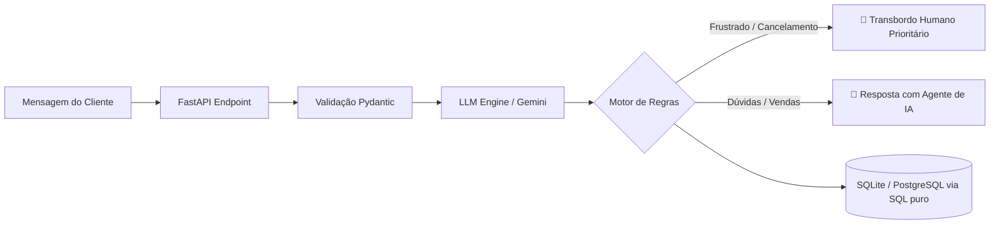

# 🤖 Smart Router Agent (AI Conversational Router)

Um microsserviço de alta performance em **Python (FastAPI)** projetado para mensageria corporativa e plataformas conversacionais (como WhatsApp e WebChat). O sistema intercepta mensagens de clientes, classifica semântica e sentimento via **LLM (Google Gemini / OpenAI)** e decide dinamicamente a rota ideal: resposta automática ou **Transbordo Humano prioritário (*Human Hand-off*)**.

---

## 🎯 Problema de Negócio & Motivação (Cenário Blip)

Em operações de atendimento em grande escala:
1. Clientes insatisfeitos ou com risco de cancelamento ficam presos em menus numéricos lentos, aumentando a taxa de *churn*.
2. Atendentes humanos gastam energia com dúvidas repetitivas em vez de focar em retenção e vendas consultivas.
3. Falta de dados estruturados para inteligência operacional em tempo real.

O **Smart Router Agent** resolve esses gargalos combinando **IA Generativa estruturada** com **regras determinísticas de negócio** e persistência relacional com **SQL**.

---

## 🏗️ Arquitetura e Decisões Técnicas



### Stack Tecnológica
- **Linguagem:** Python 3.10+ (Tipagem estática, Type Hints e Pydantic v2).
- **Web Framework:** FastAPI + Uvicorn (Rotas assíncronas e documentação Swagger automática).
- **Inteligência Artificial:** Google Gemini API (`gemini-1.5-flash`) com Saída Estruturada em JSON.
- **Banco de Dados:** SQLite com consultas analíticas via **SQL nativo** (`GROUP BY`, `COUNT`, indexação).
- **Governança & Avaliação:** Benchmark automatizado com dataset de teste (`evaluate.py`).

---

## 🚀 Como Executar o Projeto Localmente

### 1. Clonar e preparar o ambiente
```bash
git clone https://github.com/ia8d/smart-router-agent.git
cd smart-router-agent

# Criar e ativar o ambiente virtual
python -m venv venv
# No Windows:
venv\Scripts\activate
# No Linux/Mac:
source venv/bin/activate

# Instalar dependências
pip install -r requirements.txt
```

### 2. Configurar variáveis de ambiente
Copie o arquivo de exemplo:
```bash
cp .env.example .env
```
*(Adicione sua `GEMINI_API_KEY` do Google AI Studio. Se não tiver no momento, o sistema ativa automaticamente o motor de fallback semântico).*

### 3. Iniciar o servidor FastAPI
```bash
uvicorn app.main:app --reload
```
Acesse a documentação interativa no navegador: 👉 `http://localhost:8000/docs`

---

## 🧪 Benchmark e Avaliação da IA (`evaluate.py`)

Em projetos de Engenharia de IA, não basta "chamar uma API"; é fundamental mensurar a assertividade do modelo.

Para rodar a bateria de testes automatizados com cálculo de acurácia:
```bash
python evaluate.py
```

Exemplo de saída no terminal:
```text
============================================================
🚀 INICIANDO BENCHMARK / AVALIAÇÃO DO SMART ROUTER AGENT
============================================================
[01/10] ✅ PASS | Texto: "Quero cancelar meu plano imediata..."
[02/10] ✅ PASS | Texto: "Estorno não caiu na minha conta,..."
...
============================================================
📊 RESULTADO FINAL DA AVALIAÇÃO DE IA
Total de Amostras: 10
Acurácia de Classificação de Intenção: 100.0%
Acurácia de Decisão de Roteamento/Handoff: 100.0%
============================================================
```

---

## 📊 Endpoints da API

| Método | Rota | Descrição |
|---|---|---|
| `POST` | `/api/v1/message` | Intercepta a mensagem, roda a IA, toma decisão de roteamento e salva no SQL. |
| `GET` | `/api/v1/analytics` | Retorna métricas agregadas diretamente de queries SQL do banco. |
| `GET` | `/docs` | Swagger interativo para testes no navegador. |

---

## 🧠 Lições Aprendidas & Diferenciais de Engenharia

- **Resiliência e Fallback:** Caso a API de LLM sofra lentidão ou indisponibilidade, o sistema possui regras de contingência semânticas para não travar a conversa do cliente no WhatsApp.
- **Por que migrei da automação visual para código?** Construir fluxos de mensageria no n8n me deu visão de produto e regras de negócio. Implementar o Smart Router em Python puro com FastAPI me permitiu ter controle de latência, testes automatizados e integração direta de microsserviços.
